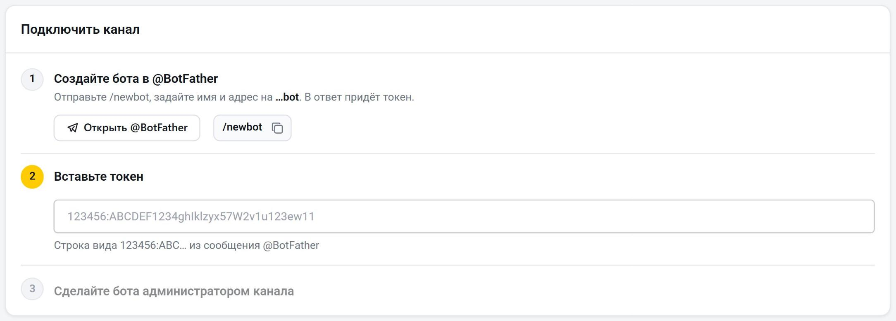
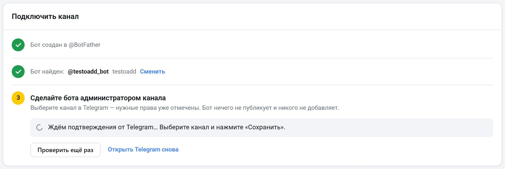
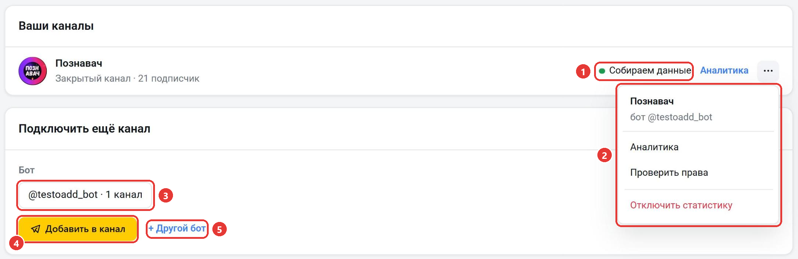

Детальную статистику собирает ваш собственный бот, которого вы подключаете к своему каналу. Через него Telemetr получает данные, которых нет в открытом доступе:

- точное число подписок и отписок по часам и по минутам;
- долю подписчиков с Telegram Premium;
- все версии отредактированных постов.

Новые посты, название и аватар канала с ботом обновляются в Telemetr сразу.

Эти данные появляются на странице канала: в [поминутной статистике](/statistika-kanala/pominutnaya-statistika), в [рекламной статистике](/statistika-kanala/reklamnaya-statistika), на графиках вкладки [«Динамика»](/analitika-kanala/dinamika), на вкладках [«Когорта по отпискам»](/analitika-kanala/kogorta-po-otpiskam) и [«Пригласительные ссылки»](/analitika-kanala/priglasitelnye-ssylki). Доля Premium-подписчиков помогает оценить качество аудитории: у ботов для накрутки Premium обычно нет.

## Как подключить

Подключить бота может только администратор канала. Детальная статистика бесплатна и работает на любом тарифе.

Откройте страницу [telemetr.me/add_log](https://telemetr.me/add_log) или выберите в меню слева «Детальная статистика». Подключение идёт в блоке «Подключить канал» и состоит из трёх шагов.

1. Создайте бота. Нажмите «Открыть @BotFather» и отправьте команду `/newbot`, её можно скопировать кнопкой рядом. Введите любое имя бота, затем адрес: он должен заканчиваться на `bot` и не быть занят. В ответ BotFather пришлёт токен бота, строку вида `123456:ABC…`.
2. Вставьте токен в поле на шаге «Вставьте токен». Нажимать ничего не нужно: Telemetr сам проверит токен в Telegram. Когда бот найдётся, шаг отметится галочкой и рядом появится адрес бота. Чтобы указать другого бота, нажмите «Сменить».
3. Нажмите «Добавить бота в канал». Откроется Telegram: выберите канал и нажмите «Сохранить». Права «Публикация сообщений» и «Добавление подписчиков» уже будут отмечены. Бот ничего не публикует и никого не добавляет: эти права нужны Telegram, чтобы бот видел новые посты и пригласительные ссылки.

Пока вы выбираете канал, страница ждёт подтверждения от Telegram. Канал определяется сам, вводить ссылку на него не нужно. Когда канал подключится, вверху страницы появится сообщение об этом, а сам канал появится в списке «Ваши каналы». Первые данные придут в течение пары часов, нажимать что-то ещё раз не нужно.

Если за три минуты Telegram ничего не прислал, на странице появится сообщение «Telegram пока ничего не прислал». Если вы уже выбрали канал и нажали «Сохранить», нажмите «Проверить ещё раз». Чтобы снова открыть выбор канала, нажмите «Открыть Telegram снова».

Если канал добавлен в [«Мои каналы»](/drugie-instrumenty-analitiki/moi-kanaly), подключить бота можно и там: нажмите на шестерёнку в карточке канала и в разделе «Детальная статистика» нажмите «Подключить».

### Если канал не подключился

Причина и кнопка для следующего действия появятся на шаге 3.

- Боту не хватает прав или он не администратор. Нажмите «Выдать права» или «Открыть Telegram снова» и сохраните права бота в Telegram.
- Бота добавил другой аккаунт Telegram. Канал подключается, только если бота добавил тот аккаунт Telegram, который привязан к вашему профилю Telemetr. Добавьте бота со своего аккаунта.
- Канала ещё нет в базе Telemetr. Публичный канал Telemetr поставит в очередь на добавление: через несколько минут нажмите «Проверить ещё раз». Если добавить канал автоматически не получилось, добавьте его в [«Мои каналы»](/drugie-instrumenty-analitiki/moi-kanaly), а закрытый канал добавьте туда по пригласительной ссылке. Затем нажмите «Проверить ещё раз».
- Канал уже собирает статистику через другого вашего бота. Нажмите «Заменить на @…», чтобы статистику собирал новый бот, или «Оставить как есть».
- Канал подключён к детальной статистике другим аккаунтом Telemetr. Если канал ваш, напишите в [поддержку](https://t.me/TelemetrSupport).
- Бот уже подключён к 80 каналам. Создайте ещё одного бота в @BotFather и подключите канал через него.

### Если к профилю не привязан Telegram

Без привязанного Telegram сайт не может проверить, что канал ваш, и сам канал не определится. [Привяжите Telegram в настройках профиля](/profil/nastroiki) или подключите канал вручную:

1. Сделайте бота администратором канала.
2. Введите в поле под шагом 3 ссылку на канал или его @username.
3. Нажмите «Подключить».

## Ваши каналы

Каналы с ботом собраны в блоке «Ваши каналы». У каждого канала указаны @username или пометка «Закрытый канал» и число подписчиков. Ссылка «Аналитика» открывает страницу канала.

1. Статус канала. Первые три часа после подключения стоит «Ждём первые данные», затем «Собираем данные». Если статистика не собирается, статус покажет причину, например «Нет права публикации», «Бот не администратор» или «Токен отозван». Наведите на статус, чтобы прочитать подсказку. Рядом появится кнопка «Вернуть права»: она откроет Telegram, где нужно снова сохранить права бота. Если токен бота отозвали в @BotFather, вместо неё будет кнопка «Вставить новый токен».
2. Меню «⋯». Вверху указан бот, который собирает статистику канала. В меню есть пункты:
   - «Аналитика». Открывает страницу канала.
   - «Проверить права». Заново проверяет права бота в канале.
   - «Открыть в Telegram». Есть у публичных каналов.
   - «Отключить статистику». Бот выйдет из канала, а подписки, отписки и правки постов перестанут собираться. Собранная статистика останется. Перед отключением сайт попросит подтверждение.

Когда у вас уже есть бот, ниже списка вместо трёх шагов показан блок «Подключить ещё канал»:

3. «Бот». Бот, которого вы добавите в следующий канал, и число каналов, к которым он уже подключён. Если ботов несколько, выберите нужного в списке.
4. «Добавить в канал». Откроет Telegram, как на шаге 3: выберите канал и нажмите «Сохранить».
5. «+ Другой бот». Открывает шаги 1 и 2, чтобы подключить нового бота по токену.

Отключённые каналы собраны внизу блока «Ваши каналы» в строке «Отключённые», нажмите на неё, чтобы раскрыть список. Чтобы снова собирать статистику канала, нажмите «Подключить снова» и сохраните бота администратором канала в Telegram.

## Чтобы статистика собиралась

- Не удаляйте бота из администраторов канала и не снимайте с него права. Без этого статистика перестанет собираться.
- Не передавайте никому токен бота.
- Не подключайте бота, которого используете в других сервисах. Для Telemetr лучше создать отдельного бота.
- Одного бота можно подключить к 80 каналам. Для следующих каналов создайте нового бота и подключите его через «+ Другой бот».

Остались вопросы? Задайте их в [нашем чате](https://t.me/telemetr_chat), и мы постараемся на них ответить.
