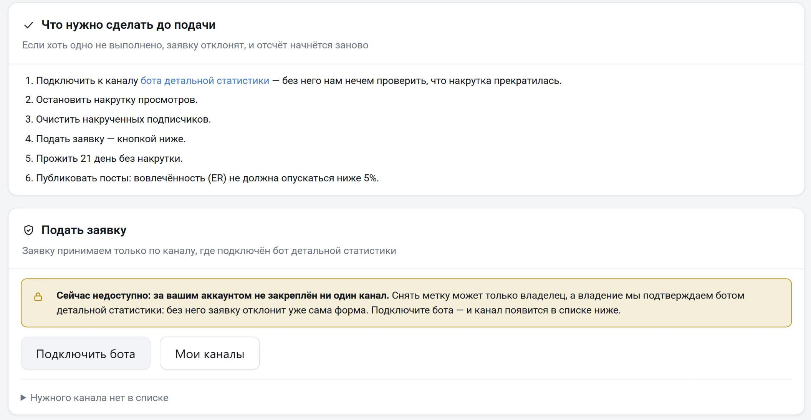

Красная метка предупреждает, что с каналом что-то не так: например, у него накручены просмотры или подписчики. Метка видна всем на странице канала, над вкладками. В ней написаны причина и дата, когда метку поставили. Если у метки есть ссылка на источник, рядом будет ссылка «Подробности».

Как работают метки:

- Метка — это результат проверки нашей команды. Если метки нет, это не значит, что канал чистый: мы могли его ещё не проверить. Любой канал перед покупкой рекламы анализируйте сами.
- Telemetr не ставит и не снимает метки за деньги.
- Telemetr не объясняет, по каким признакам поставлена метка. Иначе недобросовестные администраторы научатся обходить проверку.

Снятые метки видны на странице канала: наведите курсор на «История меток». Каналы с меткой о накрутке, меткой об обращении из-за обмана или меткой SCAM от Telegram на биржу рекламы Telemetr не принимаются.

## Какие бывают метки

- «Канал заподозрен в накрутке просмотров и/или подписчиков». У канала нашли купленные просмотры или подписчиков.
- «Канал свулканен». Канал внезапно сменил тематику и публикует мошеннические схемы: «выигрышные» ставки, казино, обещания крупных выплат за перевод денег и подобное.
- «На канал поступило обращение, связанное с невыполнением обязательств и/или обманом». Администратор канала обманул другую сторону сделки. Обычно у такой метки есть ссылка на разбор ситуации.
- «Канал украден». Канал перешёл к другому владельцу без согласия прежнего.
- «Телеграм выдал метку о мошенничестве». Метку SCAM на канал поставил сам Telegram.

## Как снять метку о накрутке

Заявку на снятие подаёт владелец канала. Владение подтверждает [бот детальной статистики](/drugie-instrumenty-analitiki/detalnaya-statistika), поэтому без него заявку не примут.

1. Подключите к каналу бота детальной статистики.
2. Остановите накрутку просмотров и очистите канал от накрученных подписчиков.
3. Откройте [профиль](https://telemetr.me/profile/marks) и выберите раздел «Снятие меток накрутки».
4. Найдите канал в списке и нажмите «Снять метку». Если канала нет в списке, раскройте «Нужного канала нет в списке» и введите ссылку на канал.

По каналу принимается одна заявка. Если её уже подал другой владелец, вместо кнопки будет надпись «заявку уже подал другой владелец канала». Если по каналу раньше отказывали из-за накрутки, рядом с кнопкой может стоять «проверка через 42 дня». После трёх таких отказов вместо кнопки написано «заявки больше не принимаются».

После подачи заявка 21 день ждёт в очереди: за это время видно, что накрутки больше нет. Метка всё это время остаётся на канале. Публикуйте посты как обычно: к проверке в канале должны быть посты за последние 7 дней, а вовлечённость (ER) не должна опускаться ниже 5%.

Когда срок выйдет, канал проверит модератор. Если он одобрит заявку, метка снимется. Если откажет, причина появится в разделе «Отклонённые заявки»: «Накрутка не удалена», «Не подключён бот детальной статистики» или «Нет постов за последние 7 дней». Иногда модератор дописывает к причине комментарий.

После отказа заявку можно подать заново. Если причина — «Накрутка не удалена», новую заявку по этому каналу проверят через 42 дня, после второго такого отказа — тоже через 42 дня. После третьего заявки по каналу больше не принимаются ни от вас, ни от другого владельца. Отказы считаются по каналу с последнего снятия метки. Отказ из-за бота или постов срок не увеличивает: исправьте причину и подайте заявку снова. Заявка бесплатная и не влияет на подписку.

## Как снять другие метки

- «Канал свулканен» не снимается.
- Метку об обмане снимают, когда конфликт урегулирован: об этом написали в канале, где публиковали разбор, или пострадавшая сторона сама сообщила в поддержку.
- Метку «Телеграм выдал метку о мошенничестве» снимают после того, как Telegram уберёт свою метку SCAM.

По этим и остальным меткам пишите в [поддержку](https://t.me/TelemetrSupport).

Остались вопросы? Задайте их в [нашем чате](https://t.me/telemetr_chat), и мы постараемся на них ответить.
