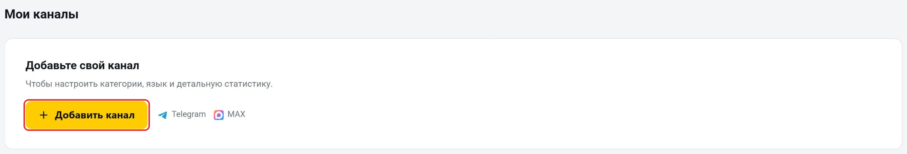
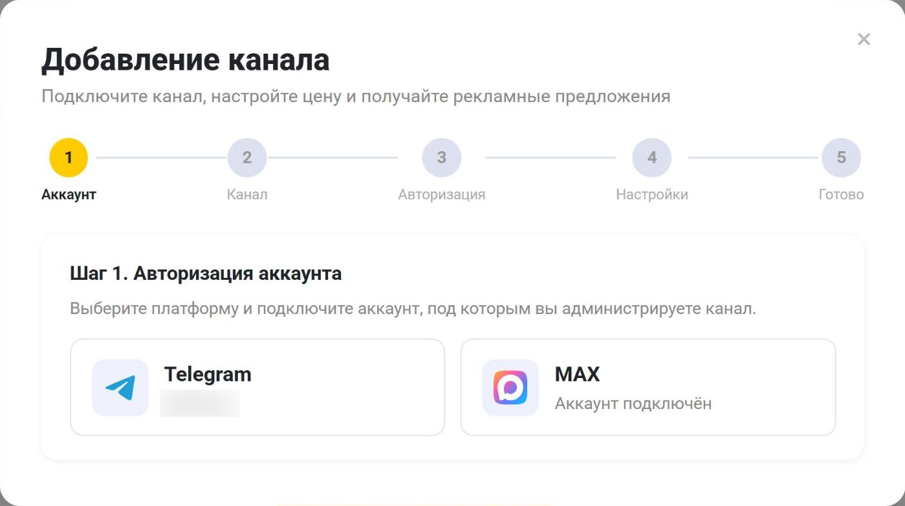
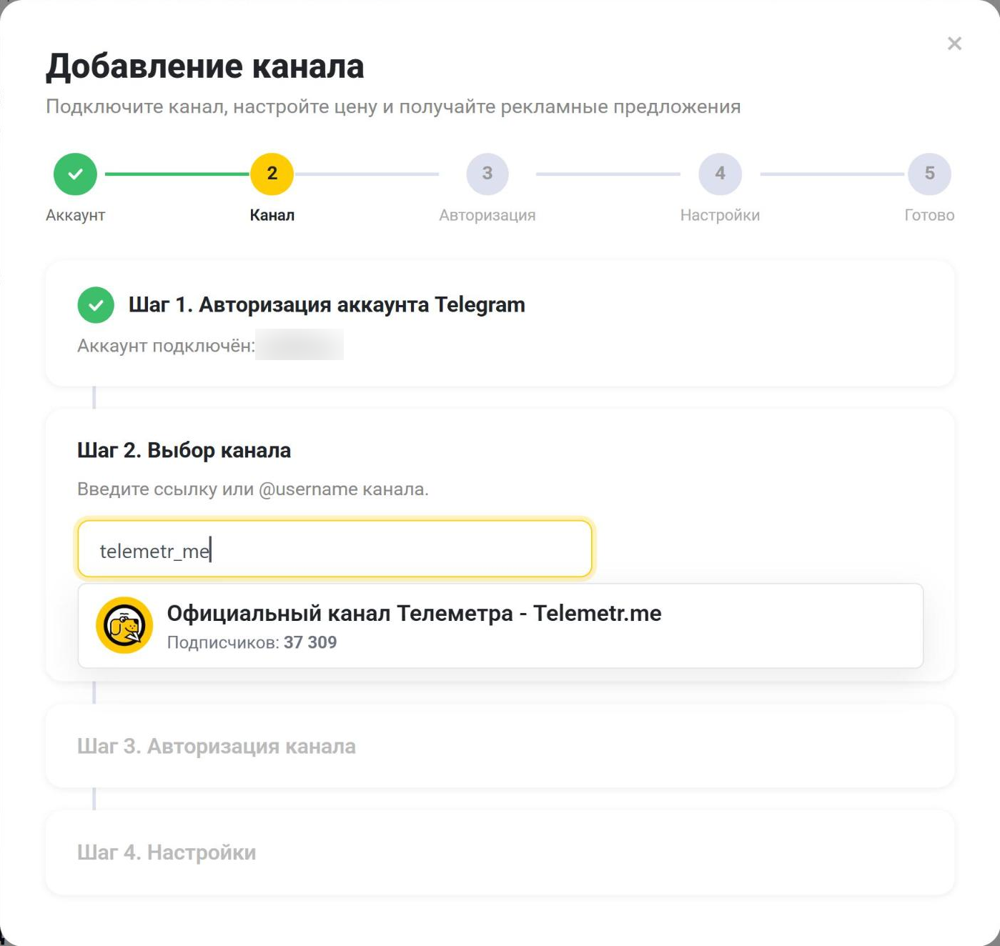
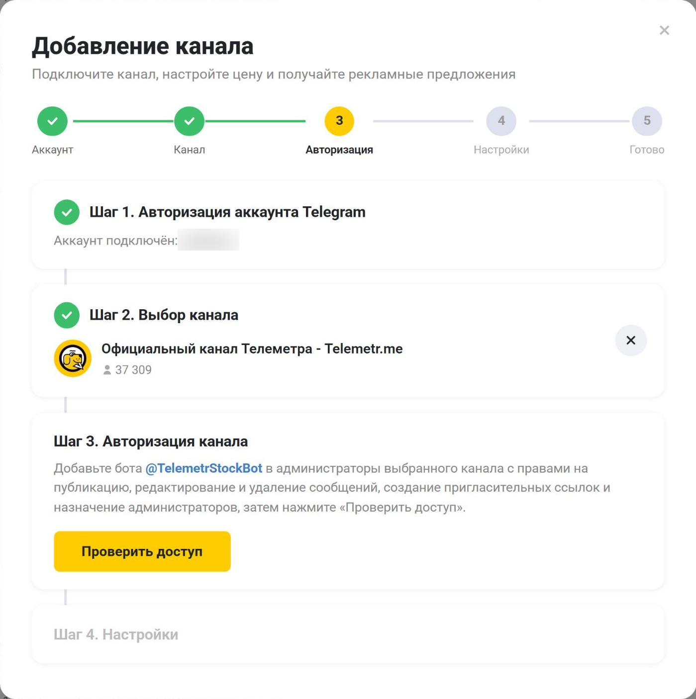

На странице «Мои каналы» собраны каналы, которые вы администрируете. Здесь видно число подписчиков каждого канала, здесь же меняются категории, язык и детальная статистика и начинается продажа рекламы на бирже Telemetr. Чтобы открыть страницу, нажмите на аватар в правом верхнем углу и выберите «Мои каналы» или перейдите по адресу [telemetr.me/my_channels](https://telemetr.me/my_channels).

Пока каналов нет, на странице показан блок «Добавьте свой канал» с кнопкой «Добавить канал». Когда каналы появятся, кнопка «+ Добавить канал» будет справа от заголовка «Мои каналы».

## Как добавить канал

Добавить канал может только его администратор. Канал попадёт в «Мои каналы», данные по нему появятся в течение суток.

1. Нажмите «Добавить канал».
2. Выберите платформу: Telegram или MAX. Если аккаунт ещё не подключён, на кнопке будет написано «Подключить аккаунт». Подключите тот аккаунт, который администрирует канал: для Telegram нажмите «Авторизоваться через Telegram», для MAX подтвердите привязку в боте: он откроется в соседней вкладке.

3. Введите ссылку на канал или его @username и выберите канал в подсказке. Нажмите «Продолжить». Для MAX вставьте ссылку вида max.ru/ваш_канал.

4. Добавьте бота биржи в администраторы канала и нажмите «Проверить доступ».
   - В Telegram это [@TelemetrStockBot](https://t.me/TelemetrStockBot). Ему нужны права на публикацию, редактирование и удаление сообщений, создание пригласительных ссылок и назначение администраторов.
   - В MAX имя бота указано в окне. Ему нужны права писать, редактировать и удалять посты и читать все сообщения.

5. Выберите категории канала, не больше трёх. Если категория у канала уже есть, она будет указана текстом. Для Telegram-канала выберите язык или оставьте «Определять автоматически».
6. Нажмите «Добавить канал». В мастере для Telegram это кнопка со стрелкой.

## Карточка канала

Каждый добавленный канал показан карточкой.

- Аватар и название канала. Нажмите на название, чтобы открыть статистику канала в Telemetr.
- @username со ссылкой на канал или пометка «Закрытый канал», ниже — число подписчиков. У MAX-канала вместо @username указан адрес max.ru или ссылка «Открыть в MAX».
- Значок графика «Аналитика». Тоже открывает статистику канала.
- Шестерёнка «Настройки». Открывает настройки канала, о них ниже.
- Строки «Категории», «Язык» и «Статистика». В «Категориях» перечислены одобренные категории, а если есть заявки на новые, рядом указано «+N на модерации». «Язык» и «Статистика» есть только у Telegram-каналов. Если что-то не настроено, рядом стоит жёлтая точка и ссылка: «Выбрать» открывает настройки, «Подключить» — подключение [детальной статистики](/drugie-instrumenty-analitiki/detalnaya-statistika).
- Строка биржи внизу карточки. Если канала нет на бирже, в ней написано «Продавать рекламу на бирже». Если канал выставлен на биржу — «На бирже · Продаётся» или «На бирже · Не продаётся». Как с ней работать, описано ниже.

## Настройки канала

Нажмите на шестерёнку в карточке канала. В окне настроек есть такие разделы:

- «Категории». У каждой категории есть крестик, чтобы снять её. Чтобы предложить новую категорию, нажмите «+ Добавить» и выберите её в списке, за раз можно предложить не больше трёх. Новые и снятые категории вступят в силу после проверки модератором, до этого рядом с ними стоит пометка. Снятую категорию можно вернуть кнопкой «Вернуть», а заявку на новую — отозвать крестиком. Хотя бы одна категория у канала должна остаться.
- «Язык». Только для Telegram. Первый пункт списка — «Автоматически»: рядом указан язык, который определил Telemetr. Если выбрать язык вручную, автоматическое определение больше не будет его менять.
- «Статистика». Только для Telegram. Показывает, подключён ли бот [детальной статистики](/drugie-instrumenty-analitiki/detalnaya-statistika). Если нет, нажмите «Подключить».
- «Медиакит канала». Есть у каналов, выставленных на биржу. Здесь ссылка на публичную страницу канала для рекламодателей, кнопка «Скопировать» и кнопка «Настроить».

Изменения категорий и языка сохраняются кнопкой «Сохранить».

Чтобы убрать канал из «Моих каналов», нажмите внизу окна «Открепить канал», а затем «Открепить». Канал будет снят с продажи на бирже. Пока у канала есть незавершённые размещения, открепить его нельзя.

## Продажа рекламы на бирже

1. Нажмите в карточке канала «Продавать рекламу на бирже».
2. Если вы продаёте рекламу впервые, заполните анкету продавца.
3. В окне условий укажите формат размещения с ценой и время, когда может выходить реклама, и нажмите «Опубликовать на бирже». В блоке «Какую рекламу принимаю» можно ограничить тематику рекламы и категории каналов рекламодателей.
4. В карточке появится строка «На бирже · Не продаётся». Нажмите на неё, чтобы включить продажу. Когда продажа включится, строка сменится на «На бирже · Продаётся», и рекламодатели увидят канал в каталоге биржи.

Если продажу включить нельзя, под строкой появится «Канал пока нельзя активировать» со списком причин и кнопками, чтобы их исправить: например, «Заполнить условия», «Проверить бота» или «Обновить ссылку».

Чтобы изменить цену и время выхода, нажмите на строку «На бирже · Продаётся» или «На бирже · Не продаётся»: откроется окно условий. Биржа не берёт комиссию с владельца канала: вы получаете всю свою цену, а комиссия биржи включена в сумму, которую платит рекламодатель. Снять канал с продажи, не открепляя его, можно в кабинете биржи. Подробнее о бирже — на странице [telemetr.me/ads](https://telemetr.me/ads).

Если бота биржи удалили из администраторов канала или сняли с него права, канал перестанет продаваться. Нажмите на строку «На бирже · Не продаётся»: откроется окно «Подключите бота к каналу» со списком нужных прав. Верните боту права и нажмите «Проверить».

Строка «Продавать рекламу на бирже» появляется у каналов от 1 000 подписчиков: меньшие каналы биржа не принимает. Каналы с меткой о накрутке, меткой об обращении из-за обмана или меткой SCAM от Telegram на биржу не принимаются, но в «Мои каналы» их добавить можно. Как снять метку о накрутке, описано на странице [«Метки о мошенничестве и накрутке»](/drugie-instrumenty-analitiki/metki-o-moshennichestve-i-nakrutke).

Остались вопросы? Задайте их в [нашем чате](https://t.me/telemetr_chat), и мы постараемся на них ответить.
