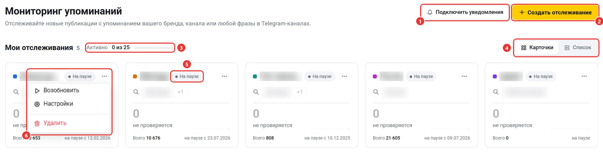
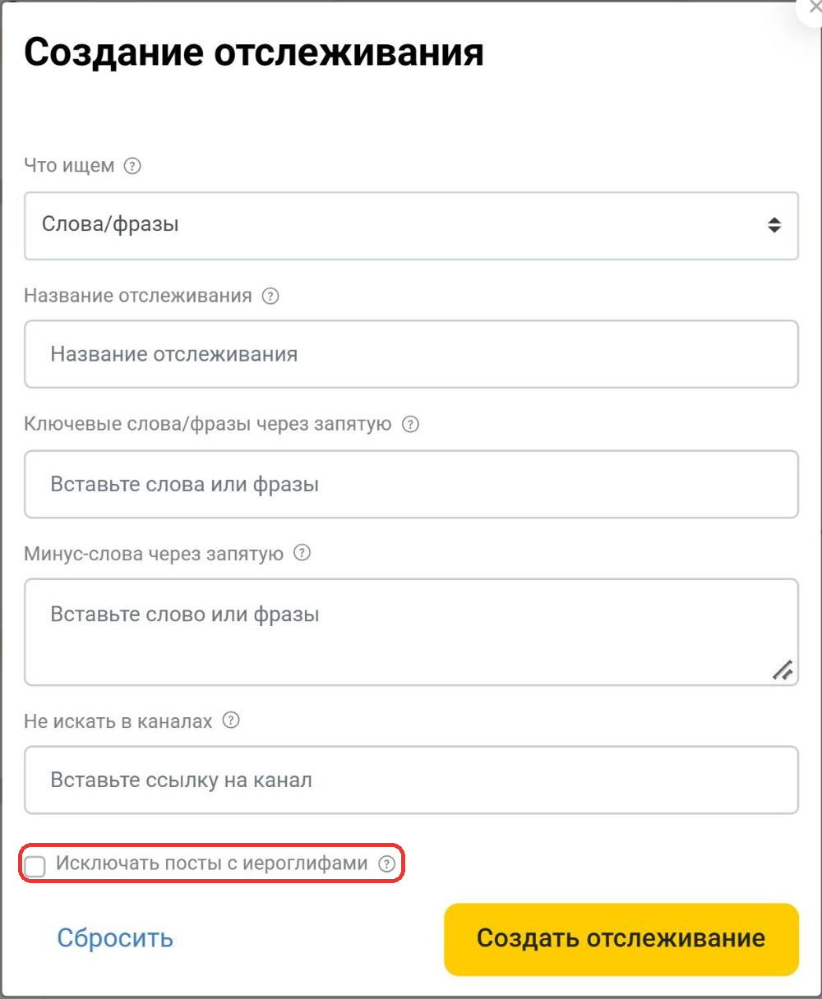
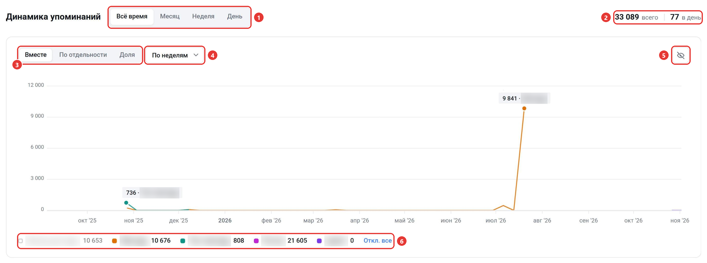
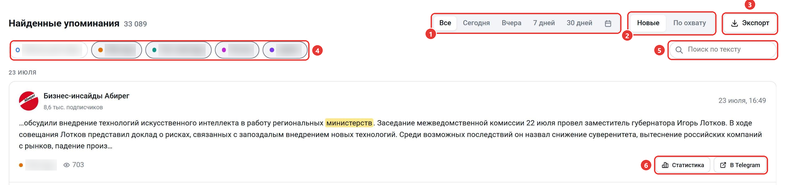
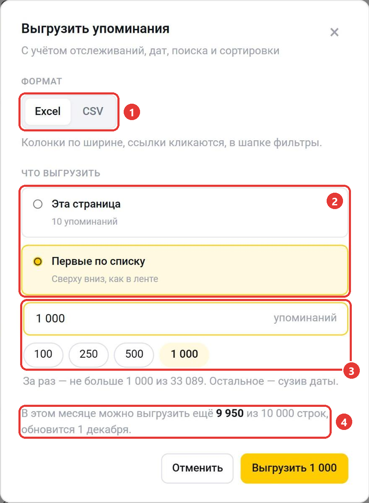

Мониторинг находит новые посты, в которых упоминается ваш бренд, канал или любое слово. Найденные посты собираются на странице мониторинга и приходят уведомлениями в Telegram. Чтобы открыть раздел, выберите в меню слева «Мониторинг» или перейдите по адресу [telemetr.me/monitoring](https://telemetr.me/monitoring).

1. «Подключить уведомления». Подключает уведомления о найденных постах в боте [@telemetr_notif_bot](https://t.me/telemetr_notif_bot). После подключения на месте кнопки появится ваш @username, в его меню можно сменить аккаунт или отвязать уведомления.
2. «Создать отслеживание». Открывает окно настройки нового отслеживания.
3. «Активно». Сколько отслеживаний сейчас включено и сколько разрешает тариф. Если есть тариф с большим лимитом, рядом будет ссылка «Увеличить лимит».
4. «Карточки» и «Список». Меняют вид: карточки или таблица с колонками «Название», «Что ищем», «14 дней», «Новых» и «Статус».
5. Статус отслеживания: «Активно» или «На паузе». Нажмите на статус, чтобы поставить отслеживание на паузу или возобновить его.
6. Меню «⋯». В нём есть пункты «Поставить на паузу» или «Возобновить», «Настройки» и «Удалить».

В карточке отслеживания указаны ключевые слова или канал, который вы отслеживаете. Если слов много, часть из них скрыта под «+N», нажмите на него, чтобы увидеть все. Если в отслеживании есть минус-слова или исключённые каналы, в карточке будет строка «Исключено»: наведите на неё, чтобы увидеть список. Крупная цифра показывает, сколько постов найдено за сутки, а столбики рядом — по дням за последние 14 дней. Внизу карточки указано, сколько постов найдено всего и когда была последняя проверка. У отслеживания на паузе вместо проверки указано, с какого дня оно на паузе.

Нажмите на карточку, чтобы на графике и в списке найденных постов остались только посты этого отслеживания. Нажмите ещё раз, чтобы вернуть все.

Пока у вас нет своих отслеживаний, на странице показано демонстрационное отслеживание «Телеметр (demo)».

## Как создать отслеживание

1. Нажмите «Создать отслеживание».
2. В поле «Что ищем» выберите «Слова/фразы» или «Упоминания канала».
3. Введите название. Его видите только вы.
4. Введите ключевые слова или фразы. Для упоминаний канала вставьте ссылку на канал.
5. Если нужно, добавьте минус-слова: посты с ними не попадут в найденные.
6. В поле «Не искать в каналах» вставьте ссылки на каналы, которые нужно пропускать.
7. Если вам не нужны посты на китайском и японском, отметьте «Исключать посты с иероглифами». Тогда не будут попадать посты, в тексте которых или в названии канала есть иероглифы.
8. Нажмите «Создать отслеживание».

Как задавать ключевые слова:

- `мама, папа` — посты, где есть хотя бы одно из слов;
- `мама папа` — посты, где есть оба слова в любом месте;
- `"мама папа"` — посты, где слова стоят подряд в этом порядке.

Чтобы изменить отслеживание, откройте меню «⋯» в его карточке и выберите «Настройки».

## Динамика упоминаний

1. Период: «Всё время», «Месяц», «Неделя» или «День».
2. Сколько упоминаний найдено за период всего и в среднем за день.
3. Вид графика. «Вместе» показывает все отслеживания на одном графике, «По отдельности» — каждое на своём графике, «Доля» — какую часть упоминаний за отрезок дало каждое отслеживание.
4. Шаг графика: по часам, по дням, по неделям или по месяцам. Какой шаг можно выбрать, зависит от периода: для «Дня» по часам, для «Недели» по дням, для «Месяца» по дням и неделям, для «Всего времени» по дням, неделям и месяцам.
5. «Скрыть график». Нажмите ещё раз, чтобы показать его снова.
6. Отслеживания и число упоминаний за период. Нажмите на отслеживание, чтобы скрыть его на графике и в списке постов или показать снова. «Откл. все» скрывает все отслеживания сразу.

На графике подписаны всплески упоминаний. Нажмите на точку графика, чтобы в списке остались только посты за этот отрезок.

## Найденные упоминания

1. Даты: «Все», «Сегодня», «Вчера», «7 дней», «30 дней» или свой период в календаре. Посты отбираются по дате, когда Telemetr их нашёл, а не по дате публикации.
2. Порядок: «Новые» показывает сначала последние найденные посты, «По охвату» — посты с самым большим охватом среди последних 1 000 найденных за период.
3. «Экспорт». Выгружает найденные посты в файл, подробнее ниже.
4. Отслеживания. Нажмите на отслеживание, чтобы скрыть его посты или показать снова.
5. «Поиск по тексту». Ищет среди найденных постов. Введите не меньше двух символов.
6. «Статистика» открывает окно поста со статистикой, «В Telegram» — пост в Telegram.

В карточке поста указаны канал и число его подписчиков, дата и время публикации, отрывок текста с найденным словом, отслеживание и просмотры. Нажмите на название канала, чтобы открыть его статистику в Telemetr. Если одинаковый пост вышел в нескольких каналах, он показан одной карточкой, а остальные каналы спрятаны под кнопкой «Ещё в N каналах». На странице 10 постов, остальные — на следующих страницах.

### Выгрузка упоминаний

Выгрузка работает на тарифах «Профи», «Бизнес» и «Корпорация». Она учитывает выбранные отслеживания, даты, поиск и сортировку.

1. Формат: Excel или CSV. В Excel колонки подогнаны по ширине и ссылки кликабельны, в CSV ссылки идут отдельными колонками.
2. Что выгрузить: «Эта страница» — посты, которые сейчас на экране, или «Первые по списку» — первые посты в том же порядке, что и в списке.
3. Сколько постов выгрузить. Введите число или выберите 100, 250, 500 или максимум. За один раз можно выгрузить не больше 1 000 постов. Чтобы выгрузить остальные, сузьте даты.
4. Сколько строк ещё можно выгрузить в этом месяце.

Нажмите «Выгрузить». В файле будут отслеживание, дата поста, канал и ссылка на него, число подписчиков, ссылка на пост, охват, текст поста, медиа и дата, когда пост был найден.

## Уведомления в Telegram

1. Нажмите «Подключить уведомления».
2. В окне «Прикрепление Телеграм-аккаунта» нажмите «Авторизоваться через Телеграм». Откроется бот [@telemetr_notif_bot](https://t.me/telemetr_notif_bot).
3. Нажмите в боте «Прикрепить». Бот ответит, что аккаунт прикреплён для уведомлений.

После этого бот будет присылать каждый найденный пост. На сайте посты тоже сохраняются.

## Ограничения тарифа

Свои отслеживания можно создавать только на платных тарифах. От тарифа зависят число одновременно включённых отслеживаний, период, за который видны найденные посты, и выгрузка:

| Тариф | Активных отслеживаний | Найденные посты | Выгрузка в месяц |
|---|---|---|---|
| Старт | недоступно | за 7 дней | недоступна |
| Эконом | 1 | за 3 месяца | недоступна |
| Профи | 3 | за год | 500 строк |
| Бизнес | 10 | за 3 года | 2 500 строк |
| Корпорация | 25 | за 10 лет | 10 000 строк |

Лимит выгрузки обновляется 1-го числа каждого месяца, у выгрузки мониторинга он свой, отдельно от каталога и поиска постов. Чтобы включить больше отслеживаний или выгружать посты, [выберите тариф](https://telemetr.me/premium).

Остались вопросы? Задайте их в [нашем чате](https://t.me/telemetr_chat), и мы постараемся на них ответить.
