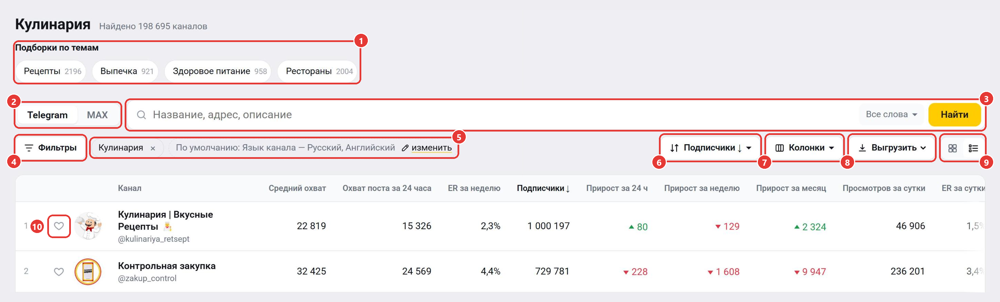
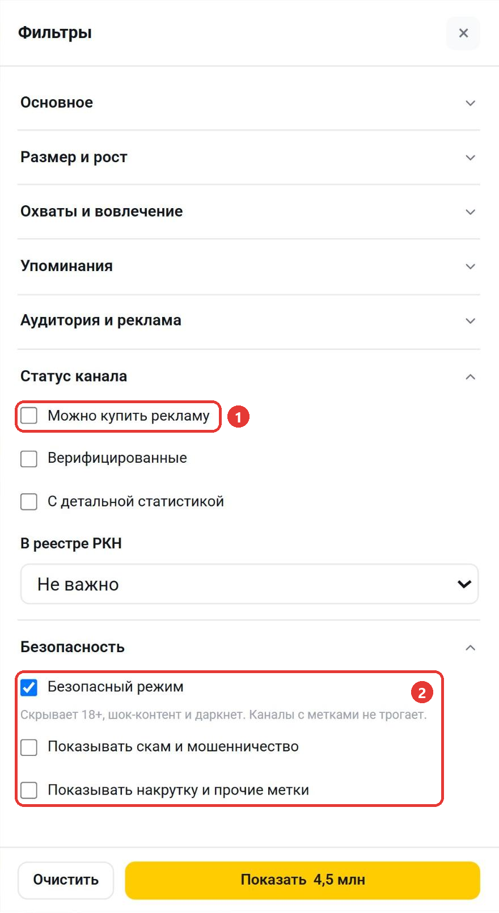
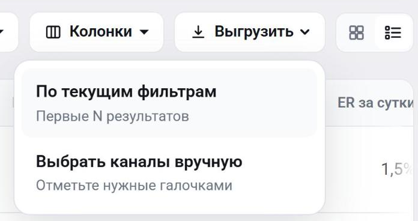
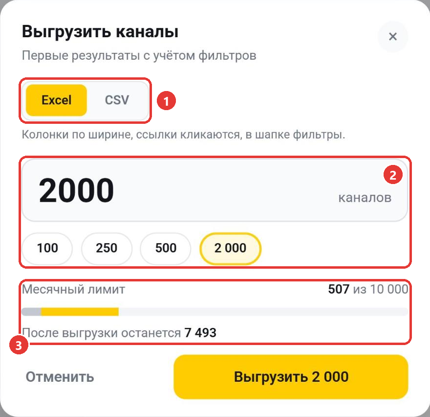

В каталоге собраны каналы из базы Telemetr. Здесь можно найти каналы по теме, размеру, охвату и другим показателям, сравнить их в таблице и выгрузить в файл. Чтобы открыть каталог, выберите в меню слева «Каталог каналов» или перейдите по адресу [telemetr.me/catalog](https://telemetr.me/catalog).

Чтобы открыть каталог одной тематики, нажмите на категорию на главной странице или на странице канала. Тогда заголовок каталога меняется на название категории, например «Кулинария».

1. «Подборки по темам». Узкие подборки внутри категории, например «Рецепты» или «Выпечка». Нажмите на подборку, чтобы оставить в выдаче только её каналы.
2. Telegram / MAX. Выберите, в какой сети искать каналы.
3. Строка поиска. Введите название, адрес или слово из описания канала и нажмите «Найти». В меню «Все слова» можно выбрать режим «Точная фраза» и включить «Искать и в описании». Если вставить ссылку на канал, например t.me/адрес, ссылку-приглашение или адрес max.ru, каталог найдёт именно этот канал, даже если его скрывают фильтры по умолчанию.
4. «Фильтры». Открывает панель фильтров (см. ниже).
5. Условия поиска. Каждое условие показано плашкой. Чтобы убрать его, нажмите на крестик. По умолчанию каталог показывает каналы на русском и английском языках. Чтобы изменить это, нажмите «изменить».
6. Сортировка. Выберите, по какому показателю упорядочить каналы: подписчики, прирост, просмотры, охват, ER, упоминания или оценка качества. Повторное нажатие на тот же показатель меняет порядок: по убыванию или по возрастанию. Пункты «Цена: сначала дешёвые» и «Цена: сначала дорогие» сортируют по цене рекламы на бирже Telemetr и сами включают фильтр «Можно купить рекламу».
7. «Колонки». Отметьте, какие столбцы показывать в таблице, и перетащите их в нужном порядке. Чтобы вернуть исходный вид, нажмите «Вернуть порядок по умолчанию». В колонке «Стоимость рекламы» указана цена размещения на бирже Telemetr, а если канал не продаёт рекламу, стоит прочерк.
8. «Выгрузить». Сохраняет каналы в файл (см. ниже).
9. Вид. Выберите, как показывать каналы: плиткой или таблицей.
10. Сердце. Добавляет канал в вашу [подборку](/katalog-kanalov/kanaly-v-zakladkakh).

Нажмите на название канала, чтобы открыть его статистику. Под таблицей можно выбрать, сколько каналов показывать на странице: 25, 50 или 100.

## Фильтры

Нажмите «Фильтры», и справа откроется панель. Условия разбиты на группы, каждая раскрывается по нажатию. Выберите условия и нажмите «Показать». На кнопке сразу видно, сколько каналов подходит. На скриншоте раскрыты группы «Статус канала» и «Безопасность».

- «Основное»: категория, язык канала, тематическая подборка и тип канала (открытый или закрытый).
- «Размер и рост»: число подписчиков и прирост за сутки, неделю и месяц. Можно выбрать каналы, которые растут, теряют подписчиков или стоят на месте.
- «Охваты и вовлечение»: просмотры за сутки, средний охват, охват поста за 24 часа и ER за неделю.
- «Упоминания»: сколько раз канал упоминали всего, за неделю и за месяц.
- «Аудитория и реклама»: доля мужской и женской аудитории и [оценка качества](/statistika-kanala/algoritm-ocenki-kachestva-kanala).
- «Статус канала»: «Можно купить рекламу» (1), верифицированные каналы, каналы с детальной статистикой и регистрация в реестре РКН. «Можно купить рекламу» оставляет только каналы, которые продают рекламу на бирже Telemetr. Этот фильтр работает и без регистрации.
- «Безопасность» (2): безопасный режим скрывает каналы 18+, шок-контент и даркнет. Каналы с метками о накрутке и мошенничестве по умолчанию скрыты. Чтобы показать их, отметьте «Показывать накрутку и прочие метки» или «Показывать скам и мошенничество». Метки есть только у Telegram-каналов.

У числовых фильтров есть готовые диапазоны, а под ними указан разброс значений в каталоге. Чтобы сбросить все условия, нажмите «Очистить».

## Выгрузка

Нажмите «Выгрузить» и выберите вариант.

- «По текущим фильтрам». В файл попадут первые каналы выдачи.
- «Выбрать каналы вручную». В таблице появятся галочки, а сверху — «Выбрать на странице». Отметьте нужные каналы и нажмите внизу экрана «Выгрузить выбранные».

Затем откроется окно «Выгрузить каналы».

1. Формат: Excel или CSV. В Excel колонки подогнаны по ширине и ссылки кликабельны, CSV удобен для своих таблиц и скриптов.
2. Сколько каналов выгрузить. Введите число или выберите 100, 250, 500 или максимум. При ручном выборе в файл попадут отмеченные каналы.
3. Месячный лимит: сколько каналов уже выгружено в этом месяце и сколько останется после выгрузки.

Нажмите «Выгрузить». В файле будут название, адрес, ссылка, описание канала с контактами для рекламы, категории, тип канала, верификация, метки о скаме и накрутке, а также числовые колонки, которые включены в таблице.

## Ограничения тарифа

Каждый новый поиск, смена фильтров или сортировки расходует один поиск из суточного лимита. Листание страниц, переход в раздел категории, выбор колонок и вида выдачи, фильтр «Можно купить рекламу», сортировка по цене и выгрузка текущей выдачи лимит не расходуют.

| Тариф | Поисков в день | Выгрузка в Excel или CSV |
|---|---|---|
| Старт | 5 | недоступна |
| Эконом | 100 | недоступна |
| Профи | 200 | до 100 каналов за раз, 500 в месяц |
| Бизнес | 800 | до 500 каналов за раз, 2 500 в месяц |
| Корпорация | 2 000 | до 2 000 каналов за раз, 10 000 в месяц |

На тарифе «Старт» в выдаче видны первые 10 каналов. Часть колонок, например оценка качества и упоминания, скрыта, а настроить колонки нельзя. Чтобы снять ограничения, [выберите тариф](https://telemetr.me/premium).

Остались вопросы? Задайте их в [нашем чате](https://t.me/telemetr_chat), и мы постараемся на них ответить.
