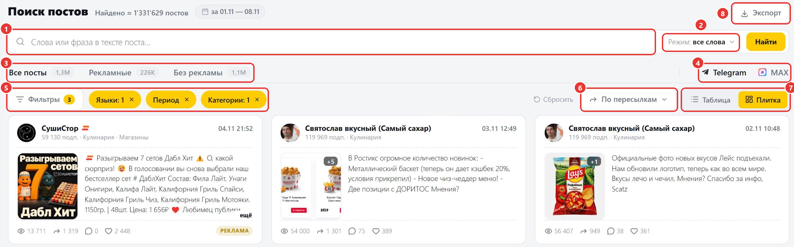
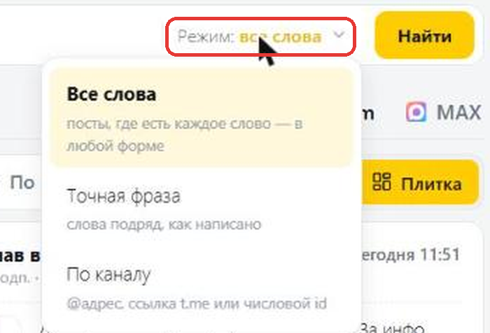
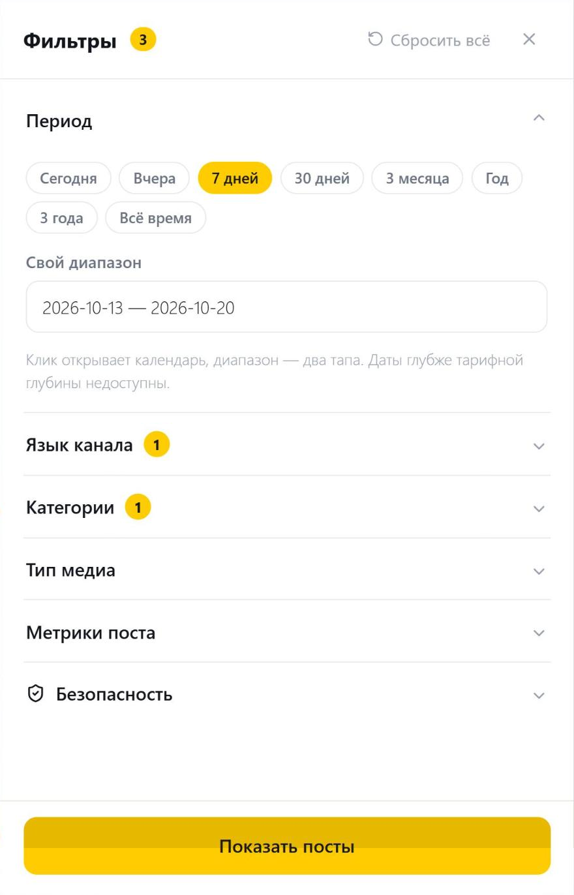
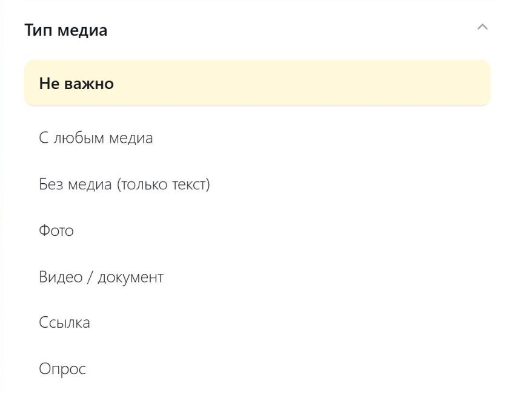
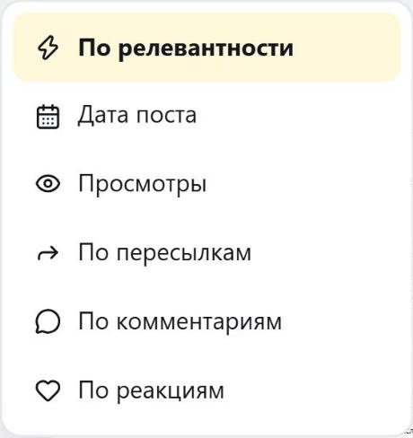
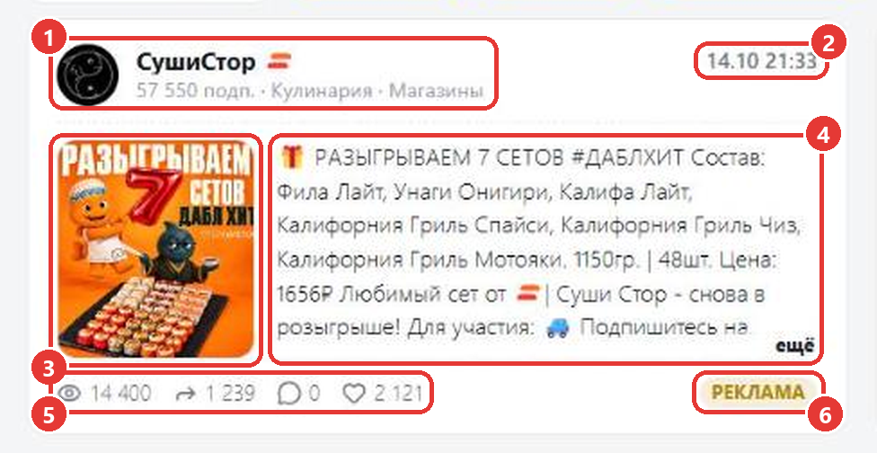
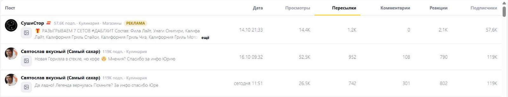
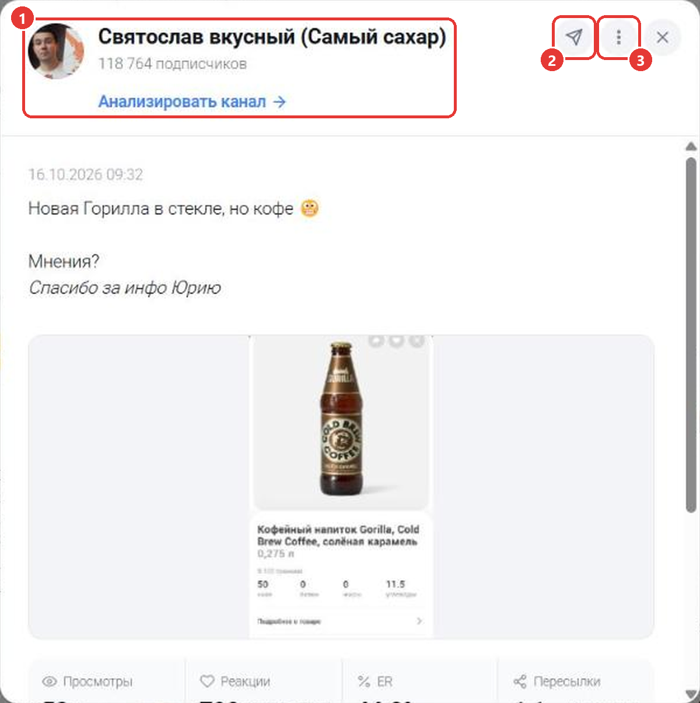
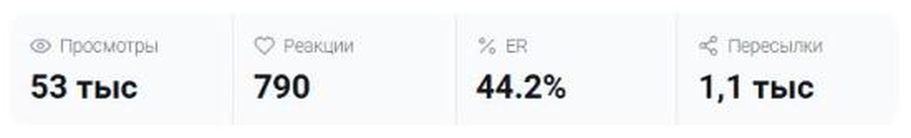
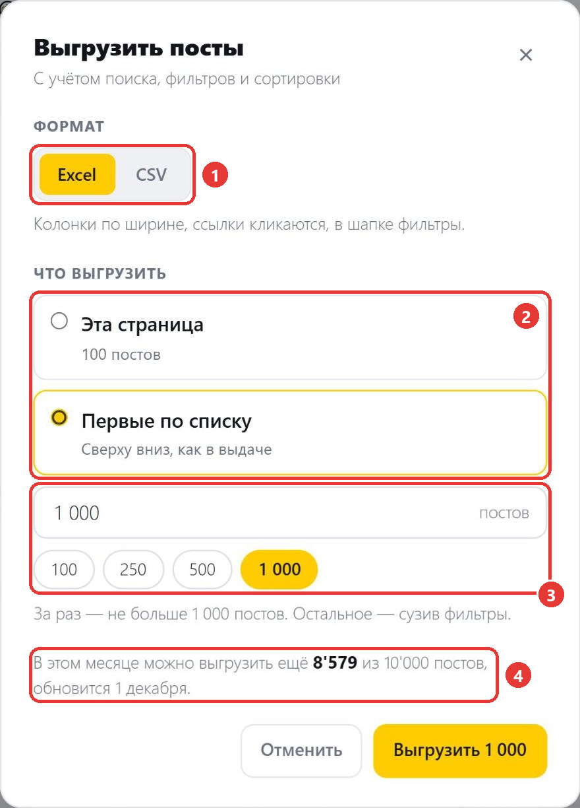

Поиск постов находит посты во всех каналах из базы Telemetr. Чтобы открыть его, выберите в меню слева «Поиск постов» или перейдите по адресу [telemetr.me/posts](https://telemetr.me/posts).

1. Строка поиска. Введите слово или фразу, которые есть в нужных постах. Чтобы найти посты одного канала, вставьте его ссылку или @username.
2. Режим поиска. Выберите, как искать: по всем словам, по точной фразе или по каналу.
3. Тип постов. Выберите вкладку: все посты, только рекламные или только без рекламы. Число рядом с вкладкой показывает, сколько примерно постов найдено.
4. Сеть. Выберите Telegram или MAX.
5. Фильтры. Нажмите, чтобы задать период, язык, категории и другие условия. Каждое выбранное условие появится отдельной плашкой. Чтобы убрать условие, нажмите на крестик на плашке.
6. Сортировка. Выберите, в каком порядке показывать посты.
7. Вид. Выберите, как показывать выдачу: плиткой или таблицей.
8. «Экспорт». Выгружает найденные посты в файл, подробнее ниже.

Над строкой поиска указано, сколько постов найдено и за какой период. Чтобы убрать все условия сразу, нажмите «Сбросить».

## Режим поиска

Нажмите «Режим» в правой части строки поиска и выберите вариант.

- «Все слова». Введите одно или несколько слов. Telemetr покажет посты, в которых есть каждое из них. Порядок и форма слов не важны.
- «Точная фраза». Введите фразу целиком. Telemetr покажет только посты, где эта фраза встречается именно так: те же слова в том же порядке.
- «По каналу». Введите @username канала, ссылку t.me или числовой id канала. Для MAX введите ссылку max.ru или числовой id. В выдаче останутся только посты этого канала.

Найденные слова подсвечиваются в тексте постов жёлтым.

<Info>
При поиске по тексту или по каналу часть фильтров не действует: язык, категории, подписчики, тип медиа, безопасный режим и реакции. Их плашки в строке фильтров зачёркнуты, а под ними написано, какие фильтры работают. Период, просмотры, пересылки и комментарии работают как обычно. В Telegram сортировка по реакциям тогда тоже не работает, и посты идут по дате.
</Info>

## Фильтры

Нажмите «Фильтры», и справа откроется панель. Выберите условия и нажмите «Показать посты».

- Период. Выберите готовый вариант (сегодня, вчера, 7 дней, 30 дней, 3 месяца, год, 3 года, всё время) или укажите свой диапазон в календаре. Даты раньше, чем позволяет ваш тариф, выбрать нельзя. Чтобы искать глубже, [смените тариф](https://telemetr.me/premium).
- Язык канала. Отметьте один или несколько языков.
- Категории. Отметьте одну или несколько тематик каналов.
- Тип медиа. Выберите, какие посты показывать: с любым медиа, без медиа (только текст), с фото, с видео или документом, со ссылкой или с опросом.
- Метрики поста. Укажите диапазоны «от» и «до» для подписчиков канала, просмотров, пересылок, комментариев и реакций.
- Безопасность. Безопасный режим скрывает посты 18+, шок-контент, даркнет и каналы с меткой накрутки. Если его выключить, в строке фильтров появится предупреждение. Здесь же можно включить «Показывать удалённые»: это посты, которые канал удалил после публикации. Их метрики сохраняются на момент удаления. По умолчанию удалённые посты скрыты, и при каждом новом поиске переключатель снова выключен.

<Note>
Если в строке поиска нет ни текста, ни канала, поиск идёт по постам за последние 355 дней (в MAX — за 90 дней). Чтобы найти более ранние посты, введите текст или укажите канал.
</Note>

## Сортировка

Нажмите на кнопку сортировки и выберите порядок.

- «Дата поста»: сначала новые посты.
- «Просмотры»: сначала посты, у которых больше просмотров. Этот вариант есть при поиске по тексту или по каналу и в MAX. В Telegram без текста и канала вместо него используйте фильтр по просмотрам.
- «По пересылкам», «По комментариям», «По реакциям»: сначала посты, у которых больше пересылок, комментариев или реакций.
- «По релевантности»: сначала посты, которые лучше всего подходят под запрос. Этот вариант появляется, когда в строке поиска есть текст, и включается сам.

В MAX нет пересылок и комментариев, поэтому сортировки по ним там нет.

## Карточка поста

1. Канал: название, число подписчиков и категории.
2. Дата и время публикации.
3. Фото или видео из поста. Число в углу показывает, сколько ещё файлов в посте.
4. Текст поста. Если текст длинный, нажмите на карточку, чтобы прочитать его целиком.
5. Просмотры, пересылки, комментарии и реакции.
6. Пометка «реклама» у рекламных постов. У постов, которые канал удалил, стоит пометка «удалён», а у постов, которые канал изменил после публикации, — «изменён» с карандашом. Наведите на неё, чтобы увидеть, когда пост изменили. В MAX пометки «изменён» нет.

## Таблица

Чтобы видеть больше постов на одном экране, нажмите «Таблица». Каждый пост займёт одну строку: канал, начало текста, дата, просмотры, пересылки, комментарии, реакции и подписчики канала.

## Окно поста

Нажмите на карточку или на строку таблицы. Откроется окно поста.

1. Канал. Нажмите «Анализировать канал», чтобы открыть его статистику в Telemetr.
2. «Открыть в Telegram». Открывает пост в Telegram. У закрытых каналов ссылка откроется только у подписчиков канала. Если пост удалён, кнопка неактивна. На тарифе «Старт» кнопка предложит сменить тариф. У постов MAX вместо неё кнопка «Открыть канал в MAX».
3. «Ещё действия». Здесь можно скопировать ссылку на пост или его текст.

Ниже показаны дата, полный текст и медиа поста, а под ними просмотры, реакции, ER и пересылки. Если у поста есть комментарии, они тоже видны в окне. Если в посте несколько фото, листайте их стрелками.

## Выгрузка постов

Выгрузка работает на тарифах «Профи», «Бизнес» и «Корпорация», на других тарифах кнопки «Экспорт» нет. Выгрузка учитывает текст поиска, фильтры, вкладку и сортировку. Нажмите «Экспорт» над строкой поиска, и откроется окно выгрузки.

1. Формат: Excel или CSV. В Excel колонки подогнаны по ширине и ссылки кликабельны, в CSV ссылки идут отдельными колонками.
2. Что выгрузить: «Эта страница» — посты, которые сейчас на экране, или «Первые по списку» — первые посты в том же порядке, что и в выдаче.
3. Сколько постов выгрузить. Введите число или выберите 100, 250, 500 или максимум. Сколько можно выгрузить за раз, указано под полем. Чтобы выгрузить остальные, сузьте фильтры.
4. Сколько постов ещё можно выгрузить в этом месяце.

Нажмите «Выгрузить». В файле будут дата поста, канал, число подписчиков, категории, ссылка на пост, текст, просмотры, пересылки, комментарии, реакции, пометка о рекламе и ссылка на медиа. В выгрузке постов MAX нет категорий, ссылки на пост, пересылок, комментариев и пометки о рекламе.

Выгрузка по тем же условиям, что на экране, лимит поисков не тратит.

## Ограничения тарифа

Глубина поиска, число поисков в день, размер выдачи и выгрузка зависят от тарифа:

| Тариф | Глубина поиска | Поисков в день | Постов в выдаче | Выгрузка в месяц |
|---|---|---|---|---|
| Старт | 7 дней | 10 | 10 | недоступна |
| Эконом | 3 месяца | 100 | до 200 | недоступна |
| Профи | 1 год | 200 | до 400 | 500 постов |
| Бизнес | 3 года | 800 | до 600 | 2 500 постов |
| Корпорация | 10 лет | 2 000 | до 1 000 | 10 000 постов |

Листание страниц выдачи и смена сортировки лимит поисков не тратят. За один раз можно выгрузить не больше постов, чем показано в выдаче. Лимит выгрузки обновляется 1-го числа каждого месяца, у выгрузки постов он свой, отдельно от каталога и мониторинга.

По умолчанию поиск открывается за последний год. Если тариф даёт меньше, то за всю доступную глубину. Чтобы искать дальше в прошлое, [выберите тариф](https://telemetr.me/premium) с большей глубиной.

Остались вопросы? Задайте их в [нашем чате](https://t.me/telemetr_chat), и мы постараемся на них ответить.
