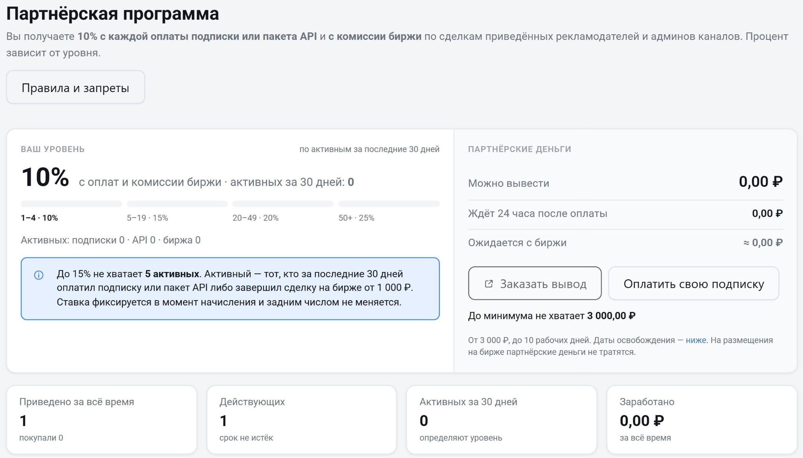

Приглашайте людей в Telemetr по своей партнёрской ссылке и получайте процент с их оплат. Чтобы открыть раздел, перейдите в [профиль](/drugie-instrumenty-analitiki/profil) и выберите «Партнёрская программа» или откройте [telemetr.me/profile/referral](https://telemetr.me/profile/referral).

## Сколько вы получаете

- Процент с каждой оплаты подписки или пакета API приведённого человека — и с первой, и со всех продлений, пока действует привязка. Оплата по счёту юрлица считается так же, как оплата картой.
- Процент с комиссии биржи рекламы Telemetr со сделок приведённых рекламодателей. Комиссию биржа берёт только с рекламодателя, поэтому за приведённых администраторов каналов процент с биржи не начисляется.

Процент один для оплат и для биржи и зависит от вашего уровня. Уровень считается по числу активных приведённых за последние 30 дней:

| Активных за 30 дней | Процент |
|---|---|
| 1–4 | 10% |
| 5–19 | 15% |
| 20–49 | 20% |
| 50 и больше | 25% |

Пока активных нет, процент тоже 10%. Активный — тот, кто за последние 30 дней оплатил подписку или пакет API либо как рекламодатель завершил сделку на бирже от 1 000 ₽. Продажа рекламы в своём канале через биржу человека активным не делает. Ставка фиксируется в момент начисления и потом не меняется.

## Партнёрские ссылки

Первая ссылка создаётся автоматически при регистрации. Ссылки находятся в блоке «Ссылки», рядом с каждой есть кнопка «Скопировать». Чтобы создать ещё одну ссылку, например для отдельной площадки, нажмите «Новая ссылка».

В таблице по каждой ссылке видно число регистраций, сколько человек что-то оплатило (столбец «Купили»), конверсию, вашу комиссию и дату последней регистрации. Ссылка «Для рекламодателей — сразу на биржу» ведёт человека сразу на биржу рекламы.

Человек закрепляется за вами, если впервые зарегистрировался в течение 30 дней после перехода по вашей ссылке. Учитывается последний переход по партнёрской ссылке перед регистрацией. Уже зарегистрированные пользователи не перезакрепляются.

### Короткая ссылка канала

У канала на бирже есть своя ссылка вида `teleme.tr/КОД`. Она открывает медиакит и работает как партнёрская ссылка владельца. Её можно скопировать в настройках медиакита: «Мои каналы» → строка «Ссылка в описании» в карточке канала.

За эту ссылку в описании активного нетестового канала Telegram или MAX можно получить подписку в подарок. Тариф, срок и статус проверки показаны в медиаките. Подарок один на аккаунт и канал за всё время, общий с подарком по коду сотрудника. Подробные шаги и условия — на странице [«Мои каналы»](/drugie-instrumenty-analitiki/moi-kanaly).

Ссылки каналов отображаются в общем списке партнёрских ссылок с типом и названием канала. В медиаките видны переходы, регистрации, покупки по ссылке и начисления.

«Купили по ссылке» — оплаченные покупки рекламы в этом канале у того же владельца в течение 30 дней после перехода, за вычетом возвратов. В показатель входят и новые, и уже зарегистрированные рекламодатели. Переход на другой канал не отменяет подходящий переход на первый. Эта статистика не равна партнёрским начислениям: покупка уже зарегистрированного человека сама по себе не делает его вашим рефералом.

Если приведённый рекламодатель покупает размещение в вашем канале, вы получаете партнёрскую долю с комиссии биржи на общих основаниях. Она считается отдельно от вашей выручки за размещение.

### Передача канала другому владельцу

После передачи прежняя короткая ссылка ведёт в каталог биржи и больше не создаёт новую привязку. Новому владельцу выдаётся своя ссылка. Переход, сделанный до передачи, может закрепить новую регистрацию за прежним партнёром до окончания 30-дневного срока. Уже закреплённые рефералы остаются у прежнего партнёра, а покупки у нового владельца не засчитываются прежней ссылке.

## Привязка

Привязка приведённого действует 12 месяцев после его последнего оплаченного дня или последней сделки на бирже, в которой он был рекламодателем. Если человек ничего не оплачивал — 12 месяцев с регистрации. Каждая оплата или сделка продлевает срок. Когда срок истёк, привязка закрывается навсегда.

В блоке «Приведённые люди» видны номера аккаунтов приведённых, что они принесли и до какого дня действует привязка. Личные данные не показываются.

## Партнёрские деньги

- «Можно вывести» — деньги, которые можно вывести или потратить.
- «Ждёт 24 часа после оплаты» — комиссия с оплат подписок и пакетов API, после которых ещё не прошли сутки. В первые 24 часа приведённый может вернуть деньги, и тогда комиссия с этой оплаты отменяется. Через сутки после оплаты деньги станут доступны сами. Если по оплате идёт возврат, комиссия ждёт, пока он закончится. Начисления с биржи приходят после выплаты администратору канала и сразу попадают в «Можно вывести».
- «Ожидается с биржи» — комиссия со сделок на бирже, которые ещё не завершены.

Партнёрскими деньгами можно оплатить свою подписку: напишите об этом в [поддержку](https://t.me/TelemetrSupport). На это можно потратить весь баланс. Оплачивать партнёрскими деньгами размещения на бирже нельзя. Как вывести деньги, описано на странице [«Выплаты»](/profil/vyplaty).

В «Журнале начислений» показано, из чего сложился заработок: начисления с оплат и с биржи, отмены и возвраты.

## Правила и запреты

За нарушение любого запрета аккаунт блокируется без выплат.

- Нельзя рассылать спам.
- Нельзя регистрироваться и платить по своим же ссылкам. За это блокируются все связанные аккаунты.
- Нельзя рекламировать сервис в поисковиках по брендовым запросам: Telemetr, Telemetr.me, Телеметр.
- За свои собственные покупки на бирже партнёрская комиссия не начисляется. Если приведённый рекламодатель покупает размещение в вашем канале, партнёрская доля с комиссии биржи начисляется.

Полный список правил открывается кнопкой «Правила и запреты» на странице партнёрской программы.

Остались вопросы? Задайте их в [нашем чате](https://t.me/telemetr_chat), и мы постараемся на них ответить.
