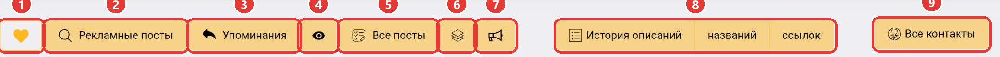
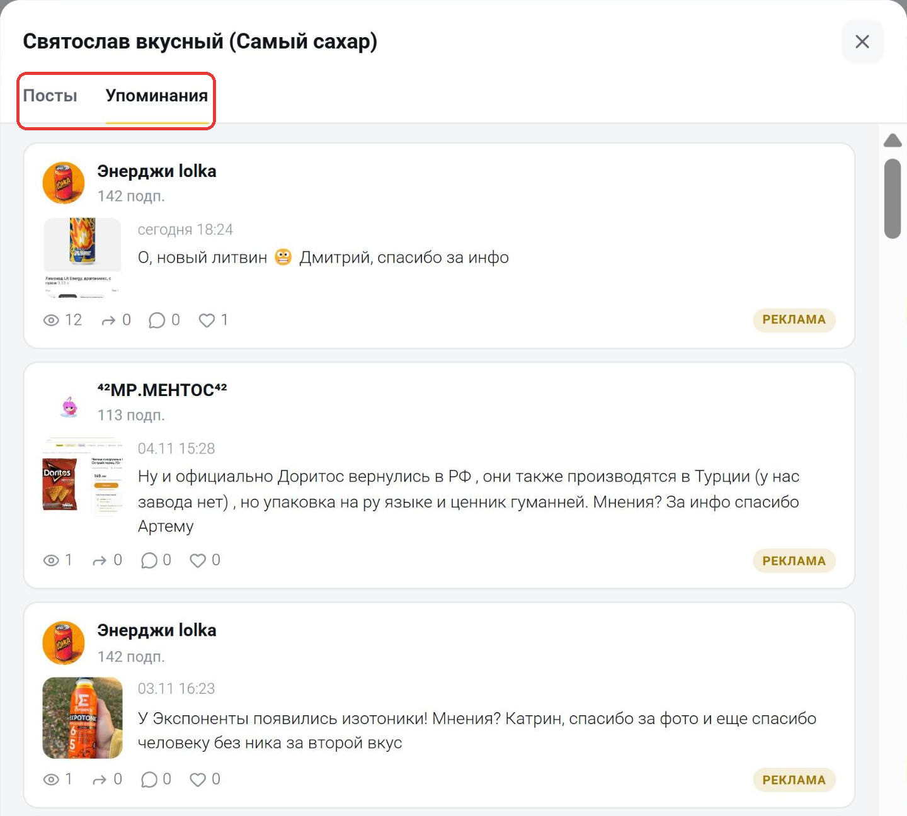

В ряду кнопок под статистикой канала есть кнопка «Упоминания» (3) и кнопка с глазом (4).

## Кнопка «Упоминания»

Нажмите «Упоминания». Откроется [поиск постов](/poisk-postov/reklamnye-posty) на вкладке «Рекламные» с постами других каналов, в которых упоминается этот канал. Так можно узнать, где канал покупал рекламу и с какими текстами.

Отдельной плашки для упоминаний в строке фильтров нет, а фильтры канала, например язык и категории, здесь не действуют: их плашки зачёркнуты. Чтобы вернуться к обычному поиску, выберите «Поиск постов» в меню слева.

## Быстрый просмотр

Нажмите на кнопку с глазом. Откроется окно быстрого просмотра на вкладке «Упоминания». В нём до 100 последних постов других каналов, в которых упоминался этот канал. Свежие посты стоят сверху. На вкладке «Посты» в том же окне собраны посты самого канала, подробнее о ней — на странице [«Все посты»](/statistika-kanala/vse-posty).

В каждой карточке есть:

- канал, который упомянул анализируемый канал, и число его подписчиков;
- дата и время публикации;
- текст поста и медиа;
- просмотры, пересылки, комментарии и реакции;
- пометка «реклама» у рекламных постов.

Нажмите на карточку, чтобы открыть пост целиком. Внизу окна есть ссылка «Все упоминания в поиске постов»: она открывает [поиск постов](/poisk-postov/reklamnye-posty) с упоминаниями этого канала.

## Ограничения тарифа

На тарифе «Старт» быстрый просмотр недоступен, а глубина поиска по кнопке «Упоминания» ограничена 7 днями. Чтобы видеть упоминания за больший срок, [выберите тариф](https://telemetr.me/premium) «Эконом» или выше.

Остались вопросы? Задайте их в [нашем чате](https://t.me/telemetr_chat), и мы постараемся на них ответить.
