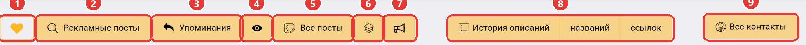
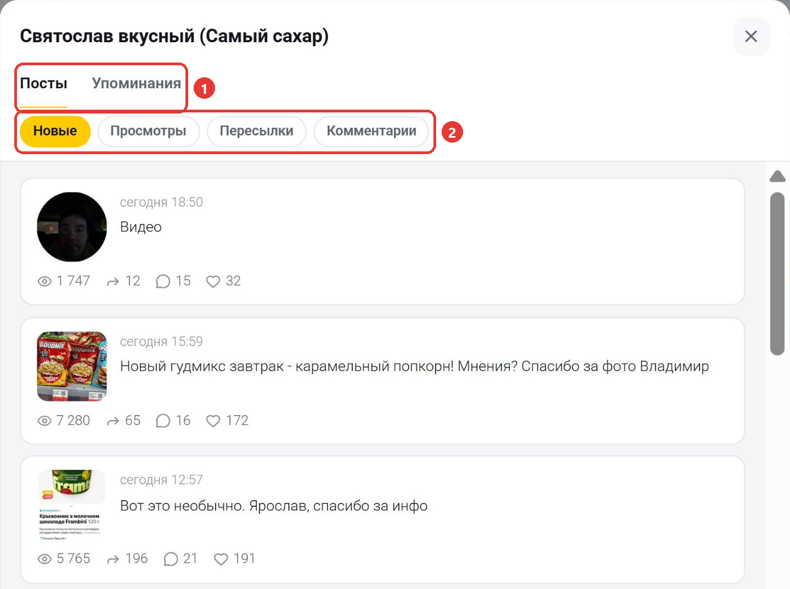

В ряду кнопок под статистикой канала есть три кнопки для постов канала: «Все посты» (5), кнопка со слоями (6) и кнопка с рупором (7).

## Кнопка «Все посты»

Нажмите «Все посты». Откроется [поиск постов](/poisk-postov/vse-posty) в режиме «По каналу» со всеми публикациями этого канала. Здесь работают фильтры по дате и метрикам, сортировка и поиск по тексту внутри канала.

## Быстрый просмотр

Нажмите на кнопку со слоями. Откроется окно с названием канала и двумя вкладками: «Посты» и «Упоминания» (1). На вкладке «Посты» собраны до 40 последних постов канала за год. Кнопка с рупором открывает то же окно, но посты в нём отсортированы по числу пересылок. Эта кнопка есть не у всех каналов.

Чтобы отсортировать посты, нажмите «Новые», «Просмотры», «Пересылки» или «Комментарии» (2).

В карточке поста указаны дата, медиа, текст, просмотры, пересылки, комментарии и реакции, а также пометки «реклама», «изменён» или «удалён». Нажмите на карточку, чтобы открыть пост целиком. Внизу окна есть ссылка «Все посты канала в поиске»: она открывает [поиск постов](/poisk-postov/vse-posty) по этому каналу.

## Ограничения тарифа

На тарифе «Старт» быстрый просмотр недоступен, а поиск по кнопке «Все посты» охватывает только последние 7 дней. Чтобы видеть больше, [выберите тариф](https://telemetr.me/premium) «Эконом» или выше.

Остались вопросы? Задайте их в [нашем чате](https://t.me/telemetr_chat), и мы постараемся на них ответить.
